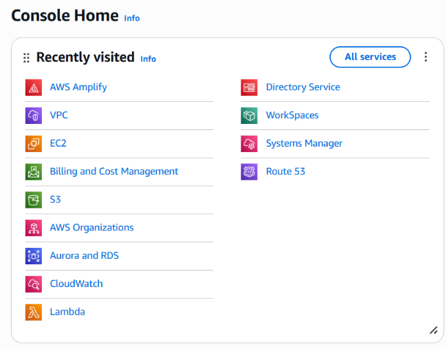

  

> *"Ingin menjadi AI Engineer namun hobi vibe coding."*

· · ────────────── · ·

*Aspiring AI & Site Reliability Engineer (SRE) · Open-Source NPM Maintainer · Cloud & Network Systems Enthusiast*

· · ────────────── · ·
